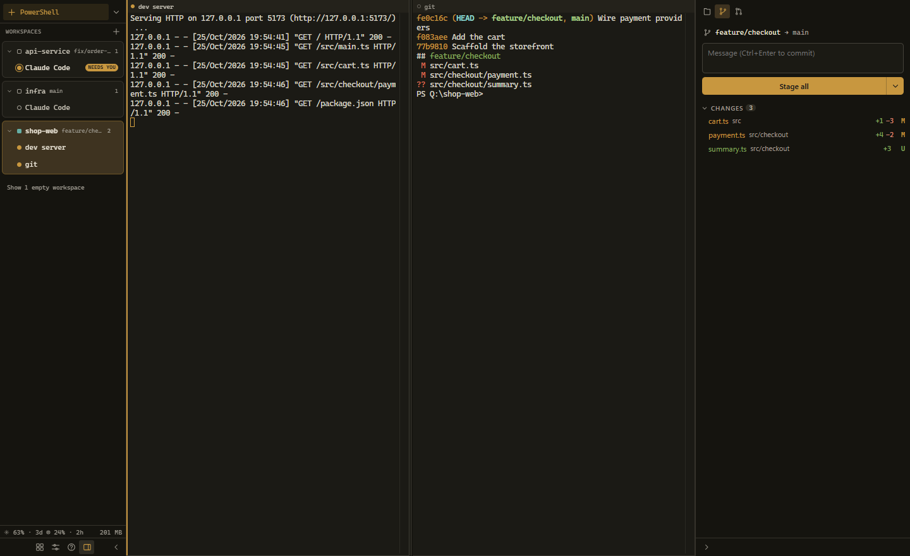
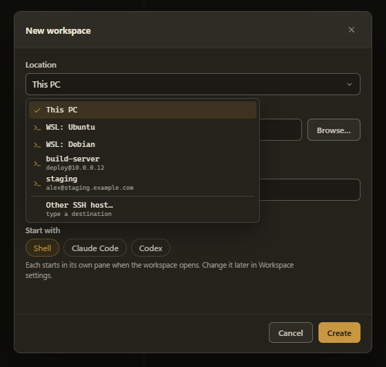
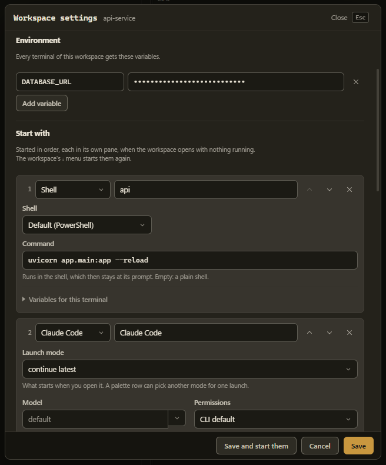
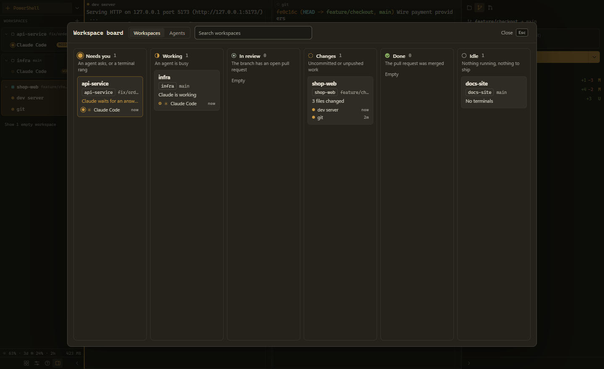
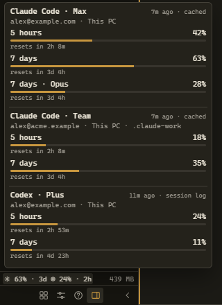
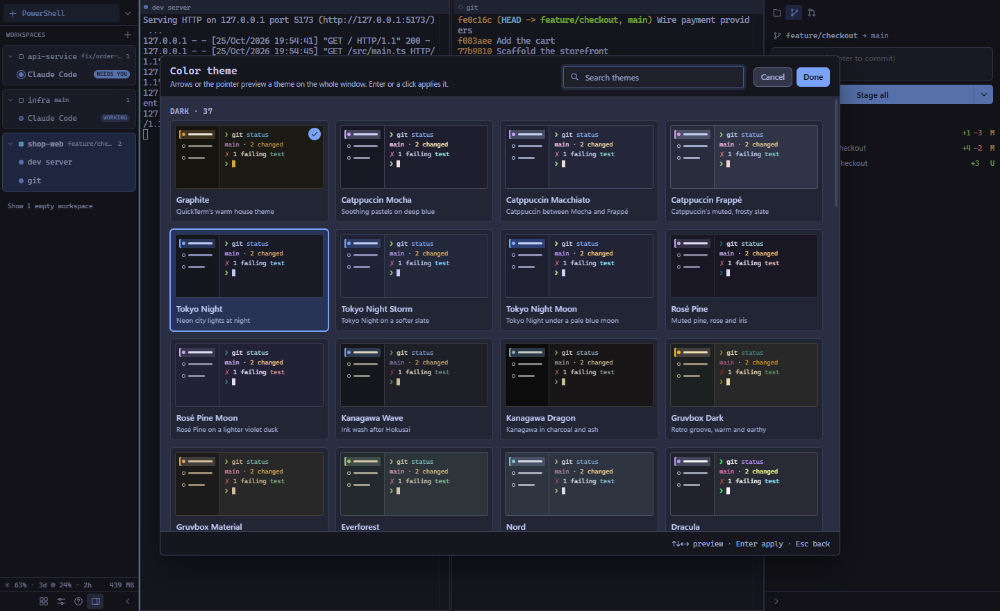
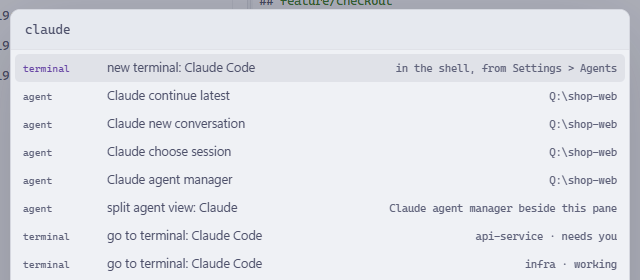

# QuickTerm

A terminal workspace for Windows. One sidebar, workspaces that live on this
PC, in WSL or on an SSH host, terminals that keep running when the window
closes, and Claude Code and Codex with their state and usage limits in view.
Everything runs on your computer: no Electron, no account, no telemetry.

[](https://github.com/devincii-io/quickterm/releases/latest)
[](LICENSE)


<picture>
  <source media="(prefers-color-scheme: light)" srcset="docs/images/workspace-light.png">
  
</picture>

- **Workspaces anywhere.** A workspace is a folder and its terminals, on this
  PC, in a WSL distribution or on an SSH host. All three work the same way.
- **Terminals outlive the window.** One background process owns every
  terminal. Close the window, reopen it, and everything is where you left it.
- **Agents in view.** Claude Code and Codex run inside your shell. The
  sidebar shows which one is working, which one waits for you, and which one
  finished, and `Alt+J` jumps to the next one that needs you.
- **Set up once.** A workspace remembers its environment variables and the
  terminals it starts with: a dev server, Claude Code, Codex.
- **A board that sorts itself** by what is happening in each workspace:
  agents, uncommitted work, open pull requests.
- **Every usage limit on this computer**, per account, in one popover.
- **Keyboard first**: a command palette, tiling splits, 54 themes.

## Install

Download `QuickTerm-v*-Setup.exe` from the
[latest release](https://github.com/devincii-io/quickterm/releases/latest) and
run it. The per-user installer needs no administrator rights, adds Start Menu
and Desktop shortcuts, upgrades in place and includes an uninstaller. A
portable `.zip` is published next to it. New versions download in the
background, and a card in the sidebar offers to install and restart.

The installer can add **Open QuickTerm here** to Explorer's right-click menu.

Windows may show a SmartScreen warning because the release binaries are
unsigned; see [Signing releases](docs/SECURITY.md#smartscreen-and-release-signing).

From source, with Python 3.12+ and [uv](https://docs.astral.sh/uv/):

```
uv sync
uv run quickterm
```

Windows 10 1809+ uses ConPTY; Linux uses the POSIX PTY backend. The backend
listens on `127.0.0.1:8620`; starting QuickTerm again brings the running
window back instead of a second copy.

## A tour

### Workspaces on this PC, in WSL or over SSH



**New workspace…** (the Workspaces **+** menu, or `Alt+K`) asks where it
lives:

- **This PC**: a Windows folder, picked in the folder browser.
- **WSL**: a folder in one of your distributions, browsed through
  `\\wsl.localhost`. Terminals open that distribution's shell in the folder.
- **SSH host**: a host from `~/.ssh/config`, or any `user@host` you type.
  Terminals are SSH sessions that start in the folder; port, key and jump
  host come from `~/.ssh/config`.

The window shows one workspace at a time; the others keep running behind it.
Files, changes, the pull request, the branch and the board work the same at
every location.

**Scratch** is a throwaway workspace in a temp folder. `cd` into a project
there and the sidebar offers **make <folder> a workspace**.

### Workspace setup



**Workspace settings** (a workspace's **⋮** menu) hold:

- **Environment**: variables every terminal of the workspace gets. Values
  are encrypted on disk and masked until you click into them.
- **Start with**: up to eight terminals, each in its own pane. A shell can
  run one command first and can be any shell installed on this PC
  (PowerShell, Command Prompt, Git Bash, a WSL distribution). Claude Code and
  Codex take their own options. Every terminal can add its own variables.

A workspace that opens with nothing running starts this list. To start it
again next to what is open, use the workspace's **⋮** menu, where the row
names what it starts (**Start dev server, Claude Code**).

### The board



`Alt+G` opens the board. Every workspace sits in the first column that
applies and moves on its own:

| Column | Means |
|---|---|
| Needs you | An agent asks, or a terminal rang |
| Working | An agent is busy |
| In review | The branch has an open pull request |
| Changes | Uncommitted or unpushed work |
| Done | The pull request was merged |
| Idle | Nothing running, nothing to ship |

Each card says why ("3 files changed · 2 commits not pushed", "PR #12 open ·
checks passing"). The Agents tab lists every agent session.

### Usage limits for every account



The sidebar footer shows the limit you are closest to (`✳ 63% · 3d`). Click
it for every Claude Code and Codex account signed in on this computer or in a
running WSL distribution. The same account found in several places shows
once, and since limits belong to the account, that also covers the same
account used over SSH. Claude's numbers come from Anthropic with Claude
Code's own sign-in (Settings > Agents > Usage limits turns that off); Codex's
come from its session logs. An account signed in only on an SSH host is not
shown.

### Themes and the palette



54 themes, dark and light. The switcher (the theme row in Settings, or
**color theme…** in the palette) previews each one on the whole window as you
move through it. On Windows 11 the title bar follows.



`Alt+K` finds anything: actions, workspaces, terminals, agents, settings and
snippets.

## Examples

**A web app that starts its dev server and an agent.** New workspace on
`C:\code\shop`, then in Workspace settings:

| Start with | Settings |
|---|---|
| Shell "dev" | command `npm run dev` |
| Shell "tests" | shell Git Bash, command `npm test -- --watch` |
| Claude Code | launch mode "continue latest" |

Environment: `VITE_API_URL=http://localhost:8000`. Opening the workspace now
gives three panes, each already running.

**A Python service in WSL.** New workspace → WSL → `Ubuntu` →
`/home/you/api`. Start with a shell running
`uv run uvicorn app.main:app --reload` and Codex. Both run in Linux; Codex
still reports its state to the sidebar.

**A server over SSH.** Add the host to `~/.ssh/config`:

```
Host staging
  HostName staging.example.com
  User deploy
  IdentityFile ~/.ssh/staging
```

New workspace → `staging` → `/srv/app`. Every terminal is an SSH session in
`/srv/app`, the right panel reads its git status there, and a Claude Code you
start there reports its state like a local one. Usage limits belong to the
account, so if you use the same Claude account on this PC its limits already
show in the footer.

**From the command line** (scripts, editor tasks):

```
quickterm new claude-code --cwd C:\code\shop --workspace shop
quickterm ls
quickterm send 3f2a "npm test" --enter
quickterm open shop
```

## Terminals and agents

The **+** at the top of the sidebar starts a terminal in your shell
(PowerShell unless Settings > General names Command Prompt, Git Bash or a
WSL distribution). Its arrow starts another shell, Claude Code or Codex, and
**+** remembers that pick. In a WSL or SSH workspace it starts that
location's shell.

Claude Code and Codex run inside the shell, so leaving the agent leaves you
at a prompt in the same folder. Settings > Agents holds their options
(model, permissions, effort and more, read from the installed CLI). A
`claude` or `codex` you type yourself in a QuickTerm PowerShell reports its
state the same way.

Splits place themselves: a new pane takes half of the focused one along its
longer side. `×` on a pane detaches it and the terminal keeps running; kill
is a separate action that always asks first.

`Alt+Shift+E` opens the right panel: the workspace's files (click to read,
Alt+click to paste the path), its git changes with stage, commit, push and
pull, and the branch's pull request with its checks.

## Command line

```
quickterm ls [--json]                         list terminals: id, name, workspace, state, folder
quickterm new [claude-code|codex] [--cwd DIR] [--workspace NAME]
quickterm open WORKSPACE                      show that workspace
quickterm send SESSION TEXT... [--enter]
quickterm --version
```

`new` opens a terminal in the running app, or starts the app with it. `send`
types into the session whose id starts with SESSION or whose name is exactly
SESSION. Every verb takes `--port N`. Exit codes: 0 done, 1 usage error or an
ambiguous SESSION, 2 QuickTerm is not running, 3 the app refused the request.
The installed `QuickTerm.exe` is a windowed program, so use
`start /wait quickterm ls` in cmd or `quickterm ls | Out-Host` in PowerShell.

## Keys

QuickTerm takes only Alt combinations your shell does not use, plus a few
Ctrl keys. `Ctrl+C` copies a selection and otherwise interrupts; `Alt+V`,
`Alt+P`, `Alt+B`/`Alt+F`, `Alt+0..9` and other shell and agent keys pass
through.

| Key | Action |
|---|---|
| `Alt+K` | Command palette |
| `Alt+N` | New terminal (what **+** starts) |
| `Alt+Shift+Right` / `Alt+Shift+Down` | Split right / below |
| `Alt+Shift+Left` / `Alt+Shift+Up` | Open the new-terminal menu |
| `Alt+Arrows` | Move between panes |
| `Alt+Z` | Zoom the focused pane |
| `Alt+D` | Detach the pane; the terminal keeps running |
| `Alt+W` | Kill the focused terminal (asks first; a second `Alt+W` confirms) |
| `Alt+J` | Next terminal that needs you |
| `Alt+G` / `Alt+S` / `Alt+I` | Board / Settings / Help |
| `Alt+Shift+S` | Sidebar: full, rail, hidden |
| `Alt+Shift+E` | Right panel |
| `Alt+Shift+C` | Open the focused terminal's folder in VS Code |
| `Ctrl+Shift+1..9` | Show the nth workspace |
| `Alt+PageDown` / `Alt+PageUp` | Next / previous open workspace |
| `Ctrl+Tab` | Recent terminals (release Ctrl to choose) |
| `Ctrl+Shift+F` | Find in the terminal |
| `Ctrl+Plus` / `Ctrl+Minus` / `Ctrl+0` | Text size |
| `Ctrl+Alt+`` ` | Summon or hide the window (global, configurable) |

## Configuration

`%APPDATA%\quickterm\config.json` is created on first run, and every field
has a control in Settings (General, Window, Shortcuts, Agents, Snippets,
Advanced, About) with a search box (`/`). Workspaces live in the
`workspaces` folder next to it. Settings > Window sets the window size and
the drop-down overlay that the summon key slides in from a screen edge.

Terminal output is never written to disk: scrollback lives in memory and
goes with the session. The log under `logs/` keeps only warnings and errors.
`QUICKTERM_DEBUG_IO=1` records raw terminal I/O for debugging and may contain
secrets.

## Security and company use

QuickTerm is built for local workstation use. It is not a sandbox:
terminals run commands with your permissions. The server binds to
`127.0.0.1` and every request needs a per-install token. What QuickTerm
reads, stores and sends (including the usage-limit request) is listed in
[Security and company deployment](docs/SECURITY.md).

## Development

```
uv sync --all-extras --dev
uv run --no-sync python scripts/check.py
uv run --no-sync pyinstaller --noconfirm --clean quickterm.spec
uv run --no-sync python scripts/smoke_packaged.py
uv build --no-sources
```

One backend process owns every PTY; windows attach over a WebSocket; the
frontend is plain ES modules with vendored xterm.js and no Node build.
[AGENTS.md](AGENTS.md) describes the architecture and the rules,
[docs/CONTRACTS.md](docs/CONTRACTS.md) the interfaces and
[CHANGELOG.md](CHANGELOG.md) the release history. The screenshots show demo
projects and demo accounts.

MIT licensed.
